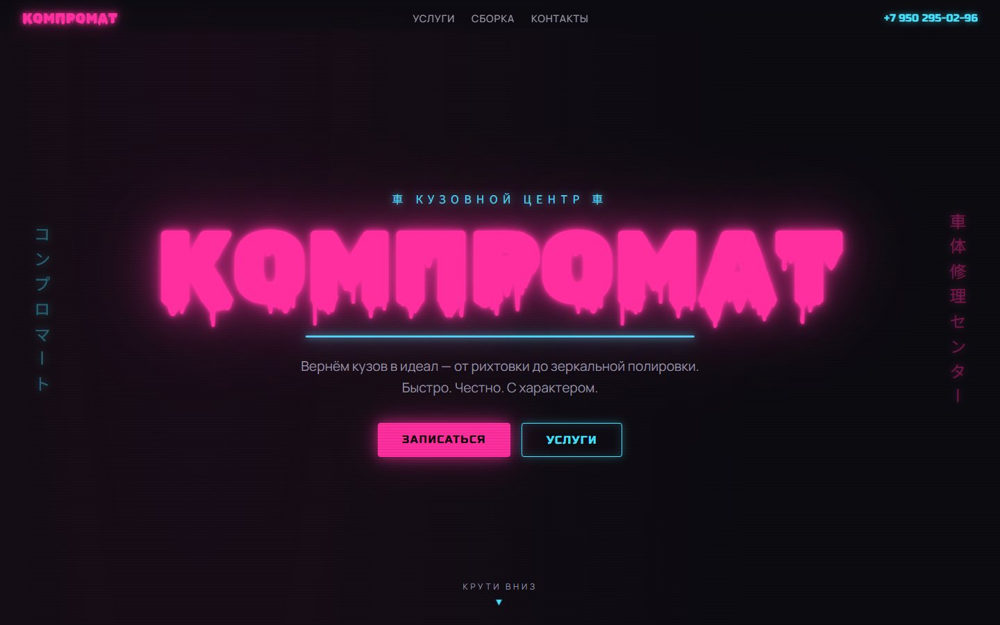
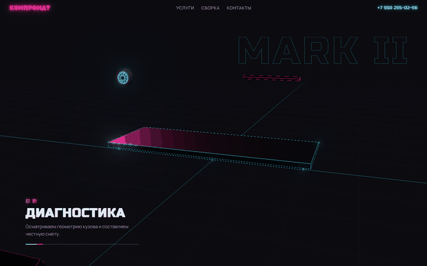
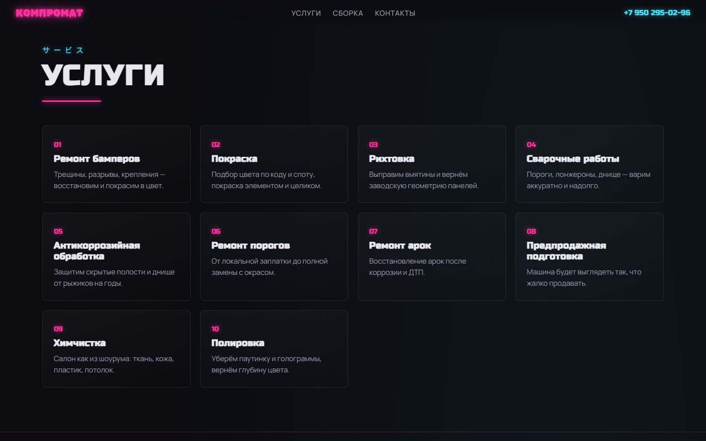
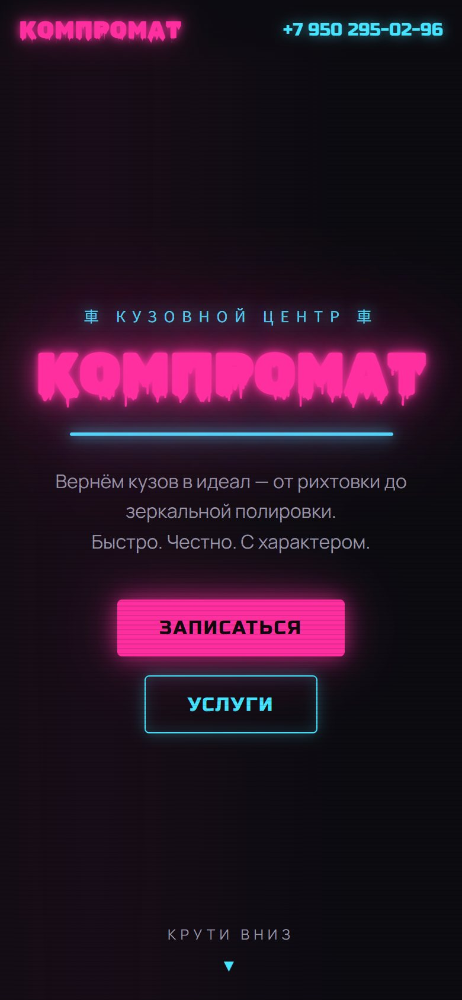

<div align="center">



# КОМПРОМАТ — кузовной центр

**Неоновый лендинг в стиле Японии и уличных гонок. Toyota Mark II собирается из деталей прямо по скроллу.**

   

</div>

<p align="center"><br><sub>Сборка машины по скроллу: диагностика → рихтовка → покраска → готово</sub></p>

<table>
<tr>
<td align="center" valign="top"></td>
<td align="center" valign="top"></td>
</tr>
</table>

<!-- header:end -->
Сайт-лендинг в стиле неон / Япония / уличные гонки. Фишка — 3D-сборка Toyota Mark II (JZX100), управляемая скроллом.

## Стек

- [Vite](https://vitejs.dev) — сборка и dev-сервер
- [Three.js](https://threejs.org) — 3D-сцена: процедурная низкополигональная Mark II с неоновыми рёбрами (EdgesGeometry) и блумом (UnrealBloomPass)
- [GSAP + ScrollTrigger](https://gsap.com) — скролл-анимация сборки (pin + scrub), появление карточек услуг

## Запуск

```bash
npm install
npm run dev      # dev-сервер на :5173
npm run build    # прод-сборка в dist/
```

## Структура

- `index.html` — разметка всех секций (хиро, бегущая строка, 3D-сборка, услуги, контакты)
- `src/style.css` — неоновая тема: розовый `#ff2fa0` / циан `#45e3ff`, шрифты Rubik Wet Paint (лого), Russo One (заголовки), Manrope (текст), Noto Sans JP (катакана)
- `src/car.js` — процедурная модель Mark II: каждая деталь — отдельная часть с `userData.home` для анимации сборки
- `src/main.js` — сцена, свет, блум, скролл-таймлайн (фазы: диагностика → рихтовка и сварка → покраска → готово), HUD с фазами

Телефон в контактах: **+7 950 295-02-96**. `prefers-reduced-motion` учитывается — без анимации показывается собранная машина.
